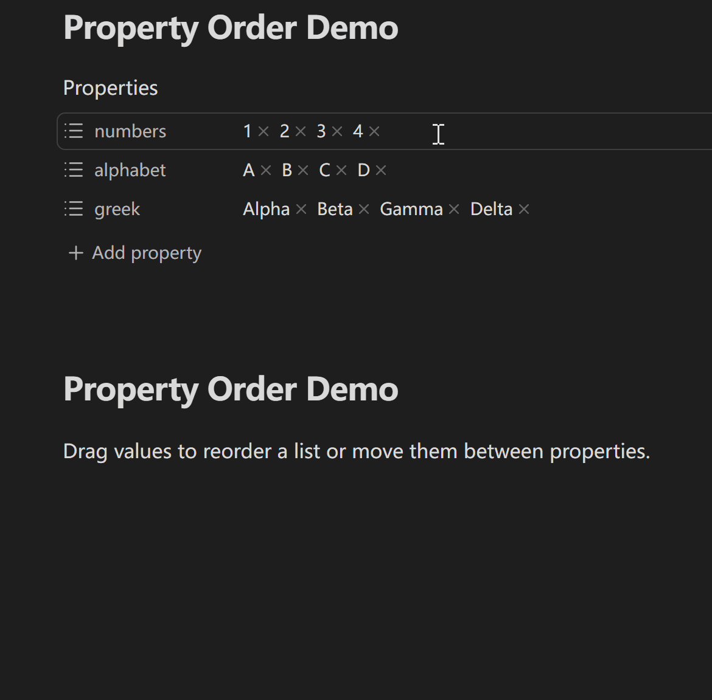

# Property Order

[English](../../README.md) · [简体中文](README.zh-CN.md) · [繁體中文](README.zh-TW.md) · [日本語](README.ja-JP.md) · [한국어](README.ko-KR.md) · [Deutsch](README.de-DE.md) · [Français](README.fr-FR.md) · [Español](README.es-ES.md) · [Português (Brasil)](README.pt-BR.md) · [Русский](README.ru-RU.md) · [Tiếng Việt](README.vi-VN.md) · [العربية](README.ar.md)

Mit Property Order kannst du Listenwerte in Obsidians Eigenschaftenansicht per Ziehen oder über die Befehlspalette neu ordnen und festlegen, welche Eigenschaftsnamen und Werte beim Tippen vorgeschlagen werden. Das Plugin sortiert Listenwerte und Eingabevorschläge, nicht die Eigenschaftsfelder selbst in der Notiz.

## Demonstration

Ziehe auf dem Desktop einen Eintrag aus einer Listeneigenschaft in eine andere derselben Notiz:



Das Ziehen zwischen Eigenschaften ist standardmäßig eingeschaltet. Du kannst es unter **Wertreihenfolge** ausschalten.

## Funktionen

- Ordne Werte in einer unterstützten YAML-Liste auf oberster Ebene per Ziehen oder über die Befehlspalette neu.
- Verschiebe Werte zwischen unterstützten Listeneigenschaften derselben Notiz. Das Ziehen zwischen Eigenschaften ist standardmäßig eingeschaltet und lässt sich ausschalten.
- Wenn Obsidian einen leeren Wert oder einen einzelnen Wert als Listeneigenschaft behandelt, kann Property Order Werte sicher hinein- oder herausverschieben. Einträge, die kein Text sind, werden mit ihrer ursprünglichen YAML-Schreibweise in Text umgewandelt.
- Behalte das aktuelle Listenformat jeder Eigenschaft bei oder wähle Listen in eckigen Klammern beziehungsweise einen Eintrag pro Zeile. Jedes erfolgreiche Neuordnen oder Verschieben erzeugt genau eine rückgängig machbare Änderung.
- Das Ziehen funktioniert auch bei Zeilenumbrüchen und in Oberflächen mit Schreibrichtung von rechts nach links (RTL). Am Rand können unterstützte Eigenschaftenbereiche automatisch scrollen. Statusänderungen werden an Bildschirmleseprogramme gemeldet.
- Passe Obsidians Vorschläge für Eigenschaftsnamen an: oben anheften, ans Ende setzen, ausblenden oder nach Name, letzter Verwendung oder Notizanzahl sortieren. Eine optionale Gruppierung nach Eigenschaftstyp ist ebenfalls möglich.
- Richte bei Bedarf Wertvorschläge je Eigenschaft ein: Obsidians Reihenfolge, Namenssortierung, bestätigte Auswahlhäufigkeit, Notizanzahl, keine Vorschläge oder eigene Vorschläge.
- Eigene Vorschläge können oben angeheftet, im normalen Bereich belassen oder ans Ende gesetzt werden. Ausdrücklich hinterlegte Werte bleiben verfügbar, auch wenn sie momentan in keiner Notiz vorkommen.
- Der Verlauf zuletzt verwendeter Namen und die Auswahlzähler für Werte ändern sich erst, nachdem Obsidian die Bearbeitung bestätigt hat. Darüberfahren, Navigieren, Abbrechen oder eine unbestätigte Bearbeitung zählen nicht.
- Kann Property Order das YAML oder Obsidians Vorschlagsoberfläche nicht sicher erkennen, bleiben die Notiz beziehungsweise die ursprüngliche Oberfläche unverändert.

## Voraussetzungen und Kompatibilität

- Obsidian 1.12.7 oder neuer.
- Auf dem Desktop können Werte direkt gezogen werden. Auf Mobilgeräten wählst du davor eine Aktion im ursprünglichen Obsidian-Menü für langes Drücken.
- Das Ziehen von Werten funktioniert nur mit YAML-Eigenschaften auf oberster Ebene, die Obsidian als Textlisten erkennt. Die Erweiterung der Wertvorschläge ordnet normalerweise Obsidians vorhandene Vorschläge neu. Eigene Regeln können zusätzlich ausdrücklich hinterlegte Werte über denselben Eigenschaftseditor anbieten. Die genauen Grenzen stehen weiter unten.

## Installation

### Community-Erweiterungen (empfohlen)

Öffne in Obsidian **Einstellungen → Community-Erweiterungen → Durchsuchen**, suche nach **Property Order** und wähle **Installieren** und **Aktivieren**. Du kannst auch die [Seite in den Community-Erweiterungen](https://obsidian.md/plugins?id=property-order) öffnen. Die folgende ZIP-Anleitung brauchst du nur für eine manuelle Installation.

### Manuelle Installation

Lade `property-order-<version>.zip` von der [neuesten Veröffentlichung](https://github.com/ZHYX91/obsidian-property-order/releases/latest) herunter und entpacke es nach `Vault/.obsidian/plugins/`. Das Archiv enthält den Ordner `property-order/` mit `main.js`, `manifest.json` und `styles.css`. Lade Obsidian neu und aktiviere Property Order unter den Community-Erweiterungen.

### Aktualisieren

Sichere und behalte `Vault/.obsidian/plugins/property-order/data.json`, sofern die Datei vorhanden ist. Ersetze nur `main.js`, `manifest.json` und `styles.css`. Lösche `data.json` nur, wenn du ausdrücklich alle Plugin-Einstellungen zurücksetzen möchtest.

## Verwendung

1. Aktiviere Property Order unter **Einstellungen → Community-Erweiterungen**.
2. Öffne eine Notiz mit YAML-Listeneigenschaften auf oberster Ebene in Obsidians Eigenschaftenansicht.
3. Ziehe auf dem Desktop einen Wert direkt. Auf Mobilgeräten drückst du einen Wert lange, wählst **Neu anordnen** oder **Neu anordnen oder verschieben** und ziehst ihn anschließend.
4. Richte unter **Namensvorschläge** die vorgeschlagenen Eigenschaftsnamen ein. Aktiviere bei Bedarf **Wertvorschläge**, um Obsidians vorhandene Wertvorschläge mit einer Standardeinstellung und Regeln je Eigenschaft zu ordnen.

**Mit der Tastatur:** Öffne Obsidians Befehlspalette und starte **Property Order: Eigenschaftswerte umordnen**. Wähle Quelleigenschaft und Wert, dann **Nach oben**, **Nach unten** oder **In Eigenschaft verschieben**. Beim Wechsel in eine andere Eigenschaft wird der Wert hinten angefügt. Der Befehl funktioniert auch bei deaktiviertem Ziehen; die Einstellung für eigenschaftsübergreifendes Ziehen gilt nur für Zeigeraktionen. Vor dem Start lässt **Escape** oder **Abbrechen** die Notiz unverändert. Warte nach dem Start auf den Abschluss; ein fertiger Schritt lässt sich im Editor rückgängig machen. Es ist kein Tastenkürzel voreingestellt.

**Vor dem Neuordnen:** Beim Neuordnen oder Verschieben in einer unterstützten Textliste können YAML-Werte zu Zeichenfolgen werden: Aus `true` wird `"true"`, aus `123` wird `"123"`. Prüfe das Ergebnis, wenn diese Datentypen wichtig sind.

**Mobil:** Ziehen ist erst möglich, wenn Obsidians eigenes Menü nach langem Drücken **Neu anordnen** oder **Neu anordnen oder verschieben** anbietet. Ist die Menüerweiterung nicht verfügbar, zeigt das Plugin kein nachgebautes Menü; die native Bearbeitung bleibt erhalten.

**Welche Vorschlagseinstellung ist gemeint?** Wenn du eine neue Eigenschaft anlegst und ihren **Namen** eingibst, bestimmt **Namensvorschläge**, ob Namen wie `status` oder `owner` angeheftet, ausgeblendet oder neu sortiert werden. Sobald du `status` gewählt hast und den **Wert** bearbeitest, steuert **Wertvorschläge** die vorhandenen Werte, beispielsweise `todo` oder `done`. Du kannst dort auch eigene Werte hinterlegen. Wertvorschläge sind standardmäßig ausgeschaltet. Das Ändern der Vorschlagseinstellungen bearbeitet keine Notiz. Das Auswählen oder Bearbeiten einer Eigenschaft in Obsidian kann die Notiz ändern.

**Beispiel: häufige Werte für `status` hinterlegen.** Öffne **Wertvorschläge**, schalte **Vorschläge für Eigenschaftswerte anpassen** ein und füge eine Regelgruppe mit **Eigene Vorschläge** hinzu. Füge `status` zu dieser Gruppe hinzu. Gib unter **Angeheftete Vorschläge** den Wert `todo` ein und wähle **Eigenen Vorschlag hinzufügen**. Wiederhole das für `doing` und `done`. Beim Bearbeiten von `status` werden diese Werte passend zu deiner Eingabe vorgeschlagen. Damit ein hinterlegter Wert an der normalen Sortierung teilnimmt, klicke daneben auf **↔ (Zu normalen Vorschlägen)**.

## Einstellungen

Alle unterstützten Obsidian-Versionen verwenden dieselben vier Einstellungsregister:

- **Allgemein** enthält die Plugin-Sprache und optionale Hinweise zur Fehleranalyse. Oberfläche und README sind auf Englisch, vereinfachtem Chinesisch, traditionellem Chinesisch, Deutsch, Französisch, Spanisch, brasilianischem Portugiesisch, Russisch, Japanisch, Koreanisch, Vietnamesisch und Arabisch verfügbar. **Wie Obsidian** wählt die passende Sprache oder Englisch, wenn diese Sprache nicht verfügbar ist.
- **Wertreihenfolge** steuert das Listenformat nach dem Neuordnen und das Ziehen innerhalb einer Eigenschaft oder zwischen Eigenschaften. Wenn du das Ziehen ausschaltest, bleibt die gesonderte Einstellung zum Ziehen zwischen Eigenschaften erhalten. Eine erzwungene Umwandlung von Listen mit einem Eintrag pro Zeile in die Klammerform kann Kommentare oder Leerzeilen verlieren. Behalte bei solchen Listen das bisherige Format bei. Öffne **Formatbeispiele** neben **Listenformat nach dem Umordnen**, um dieselbe Eingabe vor der Auswahl in allen drei Formaten zu vergleichen.
- **Namensvorschläge** steuert angeheftete, ans Ende gesetzte und ausgeblendete Eigenschaftsnamen sowie die Sortierung nach Name, letzter Verwendung oder Notizanzahl. Die optionale Gruppierung nach Eigenschaftstyp ordnet normale Vorschläge den Gruppen Text, Liste, Zahl, Kontrollkästchen, Datum, Datum und Uhrzeit, Tags sowie Automatisch / nicht festgelegt zu. Innerhalb jeder Gruppe gilt weiterhin die gewählte Sortierung.
- **Wertvorschläge** muss ausdrücklich eingeschaltet werden. Eigenschaften ohne eigene Regel verwenden die Standardeinstellung. Einzelne Eigenschaftsnamen können **Nach Name**, **Auswahlhäufigkeit**, **Notizen mit diesem Wert**, **Wie Obsidian**, **Keine Vorschläge** oder **Eigene Vorschläge** zugeordnet werden.
- Eigene Vorschläge verwenden die Bereiche **Angeheftete Vorschläge**, **Normale Vorschläge** und **Vorschläge am Ende**. Du kannst Werte direkt hinterlegen. Sie bleiben dadurch auswählbar, auch wenn sie noch in keiner Notiz vorkommen.
- **Eigenschaftsreihenfolge auf dieser Seite** ändert nur die Reihenfolge in den Regelgruppen und im Editor für eigene Vorschläge. Die Eigenschaften in Notizen und ihre Wertvorschläge werden dadurch nicht neu sortiert.
- Der Verlauf zuletzt verwendeter Eigenschaftsnamen enthält höchstens 100 Namen auf dem aktuellen Gerät. Auch die Auswahlhäufigkeit wird nur auf diesem Gerät gespeichert. Beide liegen getrennt von `data.json`, werden nicht synchronisiert und lassen sich in den Einstellungen löschen.

## Einschränkungen

- Frontmatter muss normale Eigenschaftszeilen auf oberster Ebene verwenden. Ein vollständig in `{ ... }` eingeschlossenes YAML-Dokument unterstützt kein Ziehen.
- Das Ziehen von Werten funktioniert nur mit YAML-Eigenschaften auf oberster Ebene, die Obsidian als Textlisten darstellt.
- Objektlisten, verschachtelte Listen, über mehrere Zeilen geschriebene Listen in eckigen Klammern, das Ziehen von Zeilen im Quelltextmodus und das Verschieben zwischen Dateien werden nicht unterstützt.
- Auf Mobilgeräten wählst du zuerst **Neu anordnen** oder **Neu anordnen oder verschieben** im ursprünglichen Menü für langes Drücken und ziehst danach den Wert. Obsidians Aktionen zum Bearbeiten, Entfernen aus der Liste und Kopieren bleiben verfügbar.
- Manche Eigenschaften mit einer Warnung wegen eines unpassenden Typs können teilnehmen, wenn Obsidian sie eindeutig als Liste erkennt. Bei mehrdeutigen Feldern mit gemischten Werten geht das Plugin vorsichtig vor und erlaubt unter Umständen nur das Anhängen eines Werts.
- Eigene hinterlegte Vorschläge erscheinen nur beim Bearbeiten von Werten in der Eigenschaftenansicht. Öffnet Obsidian keine Vorschlagsliste, kann Property Order diese Werte neben dem Eingabefeld anzeigen. Lässt sich das Eingabefeld nicht sicher erkennen, kannst du normal weitertippen.
- Beim Umwandeln einer Liste mit einem Eintrag pro Zeile in eine Liste mit eckigen Klammern können Kommentare und Leerzeilen verloren gehen, die sich in der Klammerform nicht darstellen lassen.
- Der Tastaturbefehl benötigt einen sichtbaren, unterstützten Eigenschaftenbereich im aktiven Markdown-Fenster. Ändern sich Datei oder Werte bei geöffnetem Dialog, öffne den Befehl erneut.

## Datenschutz und Sicherheit

Property Order arbeitet lokal. Das Plugin benötigt kein Konto, lädt keine Notizinhalte hoch und ruft keinen entfernten Dienst auf.

Neuordnen oder Verschieben ändert nur die daran beteiligten Eigenschaften. Das Plugin prüft das Ergebnis, bevor es Obsidian zum Speichern der Notiz auffordert. Strukturen, die es nicht sicher verarbeiten kann, werden nicht geschrieben.

Für die Sortierung nach Notizanzahl erfasst Property Order die Markdown-Dateien und liest ihre zwischengespeicherten Frontmatter-Metadaten. Es liest nicht jeden Notiztext. Der Verlauf zuletzt verwendeter Eigenschaftsnamen und die bestätigten Auswahlzähler für Eigenschaftswerte liegen nur in Obsidians lokalem Speicher für den jeweiligen Vault auf dem aktuellen Gerät, getrennt von `data.json`. Sie lassen sich in den Einstellungen löschen.

## Entwicklung

Verwende Node.js 24.19.0 und npm 11.17.0. Installiere die in `package-lock.json` festgehaltenen Abhängigkeitsversionen und führe anschließend alle Repository-Prüfungen aus:

```bash
npm ci
npm run check
```

### Dokumentation

- [Produktanforderungen (English)](../product-requirements.en.md)
- [Interaktionsspezifikation (English)](../ux-spec.en.md)
- [Architektur (English)](../architecture.en.md)
- [Teststrategie (English)](../testing-strategy.en.md)
- [Änderungsprotokoll (English)](../../CHANGELOG.md)
- [Beitragsleitfaden (English)](../../CONTRIBUTING.md)
- [Sicherheitsrichtlinie (English)](../../SECURITY.md)

## Hilfe

- [Fragen und Antworten (Q&A)](https://github.com/ZHYX91/obsidian-property-order/discussions/categories/q-a): Fragen zur Verwendung und Einrichtung.
- [Ideen (Ideas)](https://github.com/ZHYX91/obsidian-property-order/discussions/categories/ideas): Erste Ideen für Funktionen und Arbeitsabläufe.
- [Anwendungsbeispiele (Show and tell)](https://github.com/ZHYX91/obsidian-property-order/discussions/categories/show-and-tell): Tipps, Arbeitsabläufe und Referenzumsetzungen.
- Verwende für reproduzierbare Fehler und konkrete Funktionswünsche die strukturierten [GitHub-Issue-Formulare](https://github.com/ZHYX91/obsidian-property-order/issues/new/choose).
- Melde Sicherheitslücken vertraulich über den in der [Sicherheitsrichtlinie](https://github.com/ZHYX91/obsidian-property-order/security/policy) beschriebenen Weg.

Entferne private Vault-Pfade, Notizinhalte, YAML-Werte und Zugangsdaten, bevor du etwas öffentlich veröffentlichst.

## Lizenz

[MIT](../../LICENSE) © ZhengYX
