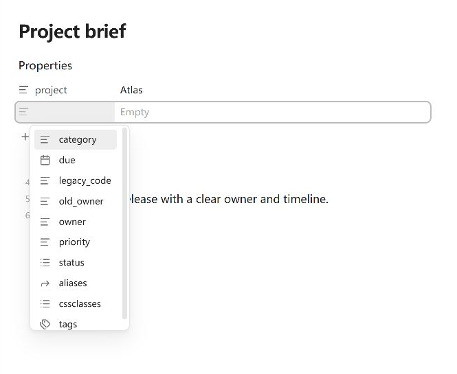
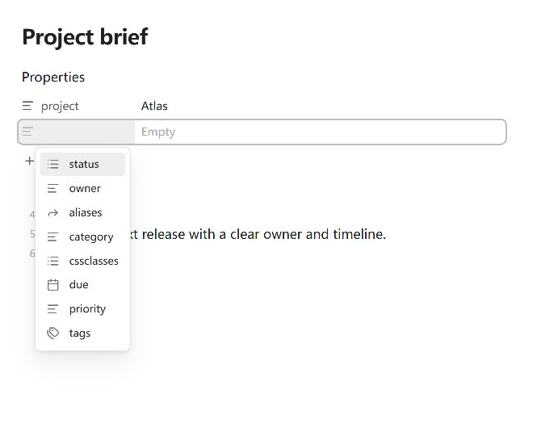
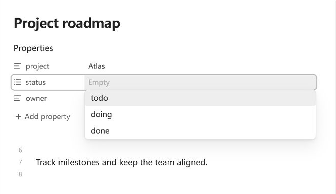

# Property Order

[English](../../README.md) · [简体中文](README.zh-CN.md) · [繁體中文](README.zh-TW.md) · [日本語](README.ja-JP.md) · [한국어](README.ko-KR.md) · [Deutsch](README.de-DE.md) · [Français](README.fr-FR.md) · [Español](README.es-ES.md) · [Português (Brasil)](README.pt-BR.md) · [Русский](README.ru-RU.md) · [Tiếng Việt](README.vi-VN.md) · [العربية](README.ar.md)

Управляйте подсказками и значениями списков в панели «Свойства» Obsidian.

- **[Подсказки имён свойств](#подсказки-имён-свойств):** закрепляйте, скрывайте, группируйте и сортируйте имена, например `status` и `owner`, при добавлении свойства.
- **[Подсказки значений свойств](#подсказки-значений-свойств):** выбирайте, какие значения предлагать для каждого свойства, включая заданные варианты `todo`, `doing` и `done`.
- **[Порядок значений списков](#порядок-значений-списков):** меняйте порядок элементов или перемещайте их между поддерживаемыми свойствами одной заметки перетаскиванием или через палитру команд.

Это независимые функции. Property Order управляет подсказками и значениями списков, но не переставляет сами поля свойств в заметке. Требуется Obsidian 1.12.7 или новее, на компьютере или мобильном устройстве.

## Подсказки имён свойств

Находите нужные имена быстрее во встроенных подсказках Obsidian при **добавлении свойства**.

1. Откройте **Настройки → Property Order → Подсказки имён**.
2. Закрепите частые имена, поместите редкие в конец и скройте ненужные по точному имени или правилу с подстановочными знаками.
3. Выберите По имени, Недавно использованные или Число заметок со свойством. Дополнительная **группировка по типу свойства** объединяет обычные варианты по типам Obsidian, оставляя закреплённые имена в начале, а помещённые в конец — в конце.

Например, закрепите `status` и `owner`, затем скройте `legacy_code`. Откройте добавление свойства в заметке, чтобы увидеть результат. Правила упорядочивают имена, которые уже предлагает Obsidian; закрепление не создаёт новый вариант и не перемещает поле в заметке.

Встроенные подсказки до применения правил:



Те же подсказки с закреплёнными частыми именами и скрытым ненужным именем:



Недавнее использование — это порядок подтверждённых добавлений, а не наведения указателя или просмотра вариантов. Сортировка по имени и недавнему использованию не обходит хранилище. Число заметок определяется по кэшированным метаданным и означает число Markdown-заметок, содержащих каждое свойство.

## Подсказки значений свойств

Управляйте значениями, предлагаемыми после выбора свойства, например `todo` и `done` для `status`. Эта функция **по умолчанию отключена** и независима от подсказок имён.

1. Откройте **Настройки → Property Order → Подсказки значений** и включите **Настроить подсказки значений свойств**.
2. Задайте режим по умолчанию для свойств без правила или назначьте точному имени свойства один из режимов: Порядок Obsidian, По имени, Частота выбора, Число заметок со значением, Без подсказок или Свои варианты.
3. Для повторно используемого списка `status` добавьте карточку правил **Свои варианты**, включите в неё `status` и с помощью **Добавить свой вариант** внесите `todo`, `doing` и `done`.



Свои варианты делятся на закреплённые, обычные и расположенные в конце. Явно заданные значения доступны, даже если их ещё нет ни в одной заметке, и фильтруются по вводимому тексту. **↔ (Переместить в обычные)** снимает фиксированную позицию, но сохраняет вариант доступным. Удаление заданного варианта из настроек не удаляет содержимое заметок.

Частота выбора учитывается только после подтверждения Obsidian, что значение записано. Число заметок означает количество Markdown-заметок с этим значением, а не число его выборов. **Без подсказок** сохраняет возможность вводить значения вручную. Изменение только правил подсказок не редактирует заметки.

## Порядок значений списков

Меняйте порядок значений поддерживаемых текстовых списков YAML верхнего уровня прямо в панели «Свойства» или перемещайте значение в другое свойство типа «Список» той же заметки. Перетаскивание между свойствами включено по умолчанию; его можно отключить в разделе **Порядок значений**.


- **Компьютер:** перетащите значение на новую позицию или в другое поддерживаемое свойство типа «Список».
- **Мобильное устройство:** нажмите и удерживайте значение, выберите **Изменить порядок** или **Изменить порядок или переместить** во встроенном меню Obsidian, затем перетащите это значение. Если расширение меню недоступно, обычное редактирование сохраняется, а плагин не заменяет меню похожей копией.
- **Клавиатура:** выполните **Property Order: Изменить порядок значений свойств** через палитру команд. Выберите исходное свойство и значение, затем переместите его вверх, вниз, на позицию начиная с 1, в начало, в конец или в конец другого свойства. Сочетание клавиш по умолчанию не назначено. Команда работает и при отключённом перетаскивании; переключатель между свойствами относится только к перетаскиванию указателем.

Каждая завершённая перестановка или перемещение создаёт одно изменение, отменяемое одним действием. До начала обновления **Escape** или **Отмена** оставляет заметку без изменений. После начала дождитесь завершения и при необходимости используйте отмену в редакторе. Перетаскивание поддерживает перенос элементов на новые строки в интерфейсе, раскладку справа налево, прокрутку у поддерживаемых краёв панели и сообщения о состоянии для программ экранного доступа.

**Проверьте типы перед изменением порядка:** нетекстовые элементы поддерживаемых текстовых списков могут стать строками: `true` превращается в `"true"`, а `123` — в `"123"`. При этом меняется тип данных. Если важны числовые или логические типы, проверьте результат.

**По умолчанию сохраняется текущий формат списка.** В разделе **Порядок значений** можно выбрать списки в скобках или по одному элементу на строку. Переход к скобкам может убрать комментарии и пустые строки; сохраняйте исходный формат, если они важны. Раскройте **Примеры формата** рядом с **Формат списка после перестановки**, чтобы сравнить варианты.

## Установка

### Плагины сообщества — рекомендуемый способ

В Obsidian откройте **Настройки → Плагины сообщества → Просмотр**, найдите **Property Order**, затем нажмите **Установить** и **Включить**. Можно также открыть [страницу плагина в каталоге сообщества](https://obsidian.md/plugins?id=property-order). Инструкции для ZIP ниже нужны только для ручной установки.

### Ручная установка

Скачайте `property-order-<version>.zip` со страницы [последнего выпуска](https://github.com/ZHYX91/obsidian-property-order/releases/latest) и распакуйте его в `Vault/.obsidian/plugins/`. Архив содержит папку `property-order/` с файлами `main.js`, `manifest.json` и `styles.css`. Перезапустите Obsidian, затем включите Property Order в разделе «Плагины сообщества».

### Обновление

Если файл `Vault/.obsidian/plugins/property-order/data.json` существует, сделайте его резервную копию и сохраните сам файл. Заменяйте только `main.js`, `manifest.json` и `styles.css`; удаляйте `data.json`, только если намеренно хотите сбросить все настройки плагина.

## Справочник настроек

Все поддерживаемые версии Obsidian используют одни и те же четыре вкладки:

| Вкладка | За что отвечает |
| --- | --- |
| **Общие** | Язык плагина и необязательные диагностические уведомления. **Как в Obsidian** выбирает соответствующий язык, а если он недоступен — английский. |
| **Порядок значений** | Перетаскивание внутри свойства и между свойствами, формат списка после перестановки. Отключение перетаскивания сохраняет отдельную настройку между свойствами. |
| **Подсказки имён** | Закреплённые, скрытые и помещённые в конец имена; сортировка по имени, недавнему использованию и числу заметок; дополнительная группировка по типу; очистка недавней истории и поле проверки правил. |
| **Подсказки значений** | Включаемый отдельно режим по умолчанию, правила для свойств, заданные варианты и очистка счётчиков выбора. |

**Порядок свойств в этих настройках** меняет порядок только в карточках правил и редакторе своих вариантов. Он не меняет поля заметок или порядок подсказок значений.

Интерфейс и README доступны на английском, упрощённом и традиционном китайском, немецком, французском, испанском, бразильском португальском, русском, японском, корейском, вьетнамском и арабском языках.

## Совместимость и ограничения

- Перетаскивание значений поддерживает обычные строки свойств YAML верхнего уровня, которые Obsidian отображает как текстовые списки. Не поддерживаются документы, целиком записанные как отображения `{ ... }`, списки объектов, вложенные списки, многострочные последовательности в скобках, перетаскивание строк в режиме исходного текста и перенос между файлами.
- Пустые и скалярные значения могут участвовать, если Obsidian определяет свойство как список. Некоторые строки с несовпадением типа также работают, если отдельные значения чётко различимы. Неоднозначные строки со смешанными значениями обрабатываются осторожно и могут разрешать только добавление в конец.
- Команде с клавиатуры нужна видимая поддерживаемая панель «Свойства» в активной области Markdown. Если файл или значения изменились при открытом диалоге, откройте команду заново.
- Заданные варианты появляются только при редактировании значений в панели «Свойства». Если встроенное окно подсказок недоступно, плагин может показать их рядом с полем ввода. Если безопасно определить редактор или встроенный интерфейс подсказок не удаётся, обычный ввод или встроенные подсказки остаются доступными.
- Перед запросом сохранения в Obsidian проверяется YAML. Неподдерживаемое или конфликтующее содержимое остаётся без изменений. Выбор или редактирование свойства в Obsidian может изменить заметку; одна лишь настройка подсказок — нет.

## Конфиденциальность и безопасность

Property Order работает локально. Он не требует учётной записи, не загружает содержимое заметок и не обращается к удалённым сервисам. Перестановка или перенос значений меняет только задействованные свойства.

Для числа заметок используются кэшированные метаданные frontmatter, а не чтение текста каждой заметки. История недавних имён (не более 100) и счётчики подтверждённых выборов значений хранятся только в локальном хранилище этого Vault на текущем устройстве, отдельно от `data.json`. Они не синхронизируются и очищаются в настройках. Наведение указателя, просмотр, отмена и неподтверждённые изменения их не обновляют.

## Разработка и поддержка

Используйте Node.js 24.19.0 и npm 11.17.0. Установите версии зависимостей, указанные в `package-lock.json`, затем выполните все проверки репозитория:

```bash
npm ci
npm run check
```

### Документация

- [Требования к продукту (English)](../product-requirements.en.md)
- [Спецификация пользовательского интерфейса (English)](../ux-spec.en.md)
- [Архитектура (English)](../architecture.en.md)
- [Стратегия тестирования (English)](../testing-strategy.en.md)
- [История изменений (English)](../../CHANGELOG.md)
- [Руководство для участников (English)](../../CONTRIBUTING.md)
- [Политика безопасности (English)](../../SECURITY.md)

- [Вопросы и ответы](https://github.com/ZHYX91/obsidian-property-order/discussions/categories/q-a): вопросы об использовании и настройке.
- [Идеи](https://github.com/ZHYX91/obsidian-property-order/discussions/categories/ideas): предварительные идеи функций и способов работы.
- [Опыт использования](https://github.com/ZHYX91/obsidian-property-order/discussions/categories/show-and-tell): советы, способы работы и примеры реализации.
- Для воспроизводимых ошибок и конкретных предложений функций используйте [формы обращений GitHub](https://github.com/ZHYX91/obsidian-property-order/issues/new/choose).
- Сообщайте об уязвимостях непублично, следуя [политике безопасности](https://github.com/ZHYX91/obsidian-property-order/security/policy) репозитория.

Перед публикацией удалите пути к личным хранилищам, содержимое заметок, значения YAML и учётные данные.

## Лицензия

[MIT](../../LICENSE) © ZhengYX
